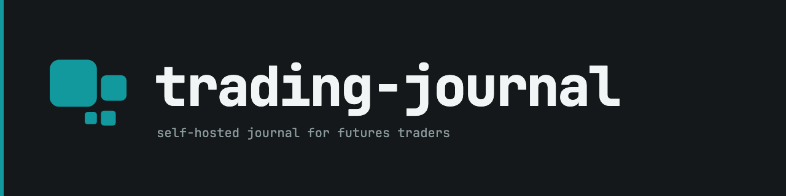
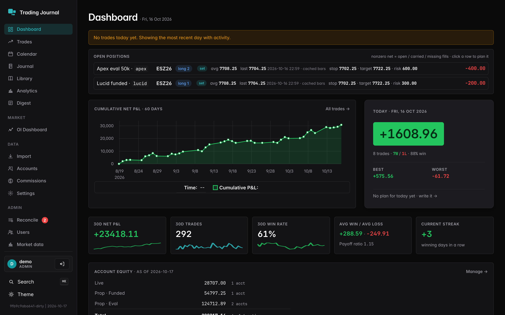
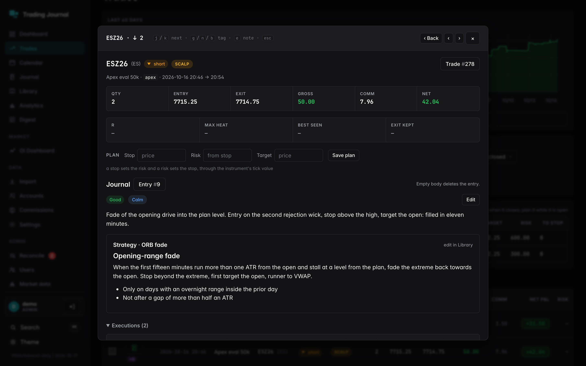
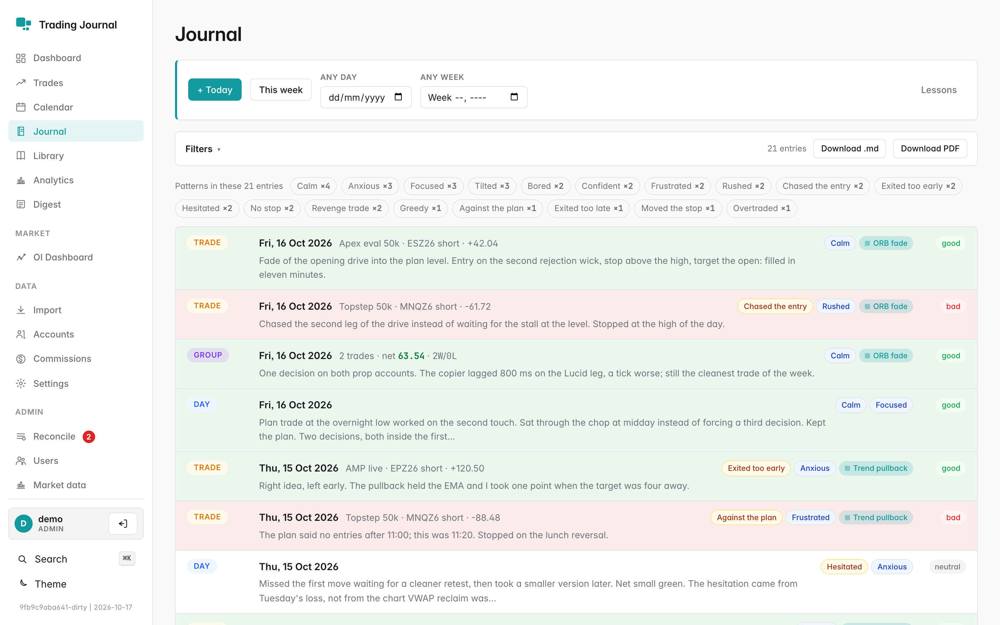
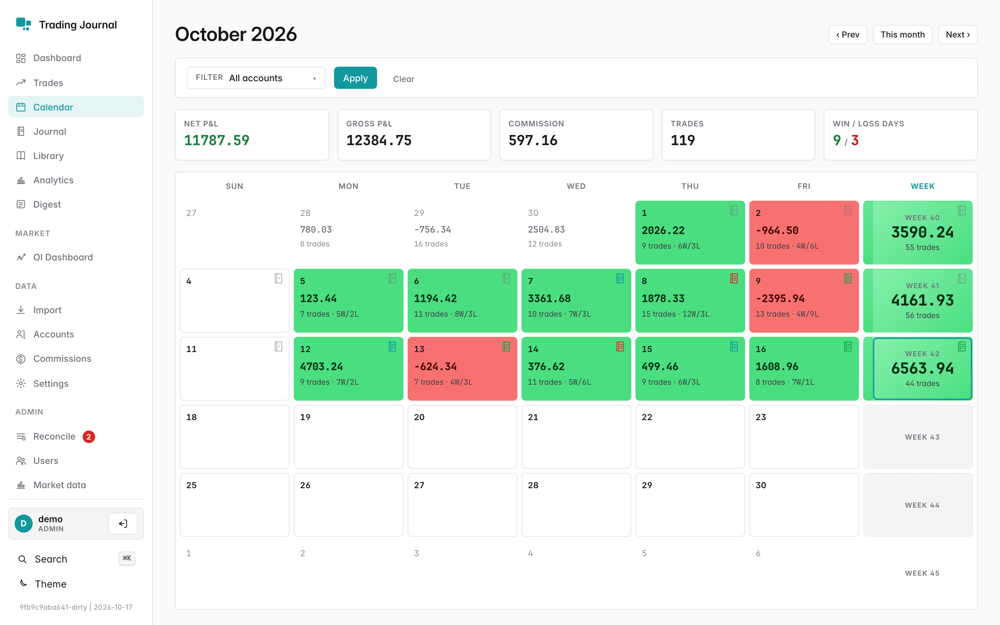
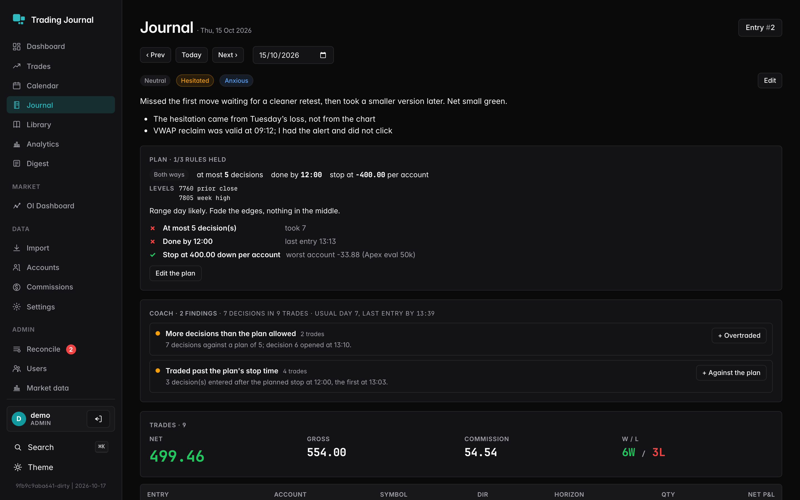
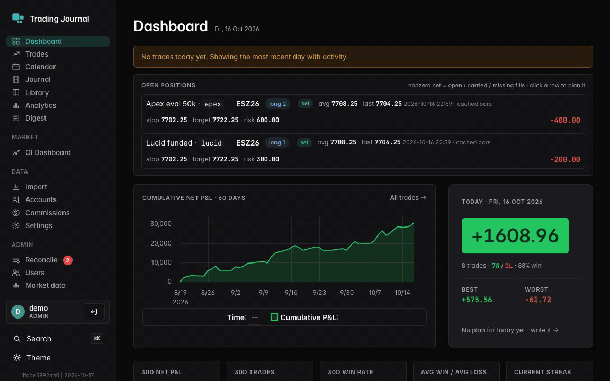

<p align="center"></p>

[](https://github.com/w4jnl/trading-journal/actions/workflows/ci.yml)

A self-hosted trading journal for futures traders. Fills arrive from MotiveWave, TopstepX and
Interactive Brokers, a FIFO builder turns them into trades, and the journal is where you plan
the day, write about the trades and get told, in your own words, when you are about to repeat
a mistake. One Go binary with SQLite, an iPhone app, and an API that AI assistants can use.

The web app is server-rendered with HTMX, so there is no JavaScript build and nothing leaves
your network unless you configure a broker, a model provider or the phone's push. Prop-firm
accounts driven by a copytrader, several accounts per decision, day plans with a max loss, a
guardrail that nudges while you trade, AI reviews that suggest but never decide: the features
are the ones a discretionary ES and NQ day trader needs, built for one trader and published
because the approach may be useful to others.

<p align="center"></p>

<p align="center">


</p>

<p align="center">


</p>

<p align="center"></p>

## Setup

Current version: 2.18.5 · [release notes](CHANGELOG.md). Linux and macOS on amd64 and arm64 run
the server; the phone app needs iOS 18 and is built from source with your own Apple team.

1. Run it. With Docker, from the `Docker/` folder of a checkout:
   ```sh
   cp config.example.yaml config.yaml
   mkdir -p data imports/{inbox,processed,failed,uploads} oi_dashboard
   sudo chown -R 65532:65532 data imports oi_dashboard     # the image runs as uid 65532
   docker compose pull && docker compose up -d
   ```
   Or from source, with Go 1.26 or newer and no cgo:
   ```sh
   go build -o trading-journal ./cmd/server
   cp config.example.yaml config.yaml
   ./trading-journal -config config.yaml     # listens on :8080, writes ./data/trading.db
   ```
2. Set the first password. The first start creates the user `admin` (`auth.bootstrap_user`):
   ```sh
   ./trading-journal users reset admin       # asks for the password; with Docker:
   # docker compose run --rm trading-journal users reset admin --config=/etc/trading-journal/config.yaml
   ```
   Open http://localhost:8080 and sign in.
3. Bring the first fills. Export the Executions view from MotiveWave (or the orders export from
   TopstepX) and drop the CSV into `imports/inbox/`, or upload it at `/import`. Accounts and
   instruments are created as they appear; trades, the calendar and the dashboard follow.
4. Connect what you trade live, under Settings: a TopstepX API key, an IBKR Client Portal
   Gateway, or MotiveWave's fill e-mails pointed at the journal's SMTP listener
   (`mw_email` in the config). [docs/data-sources.md](docs/data-sources.md) has every path.
5. Set `auth.session_secret` and `secrets.encryption_key` in the config (or the `TJ_SESSION_SECRET`
   and `TJ_ENCRYPTION_KEY` environment variables) before anyone pastes an AI or broker key;
   `openssl rand -hex 32` makes either.

`curl -f http://localhost:8080/healthz` prints `ok` once the server is up.

### More install options

- Multi-arch image `ghcr.io/w4jnl/trading-journal` (`vX.Y.Z`, `vX.Y`, `vX`, `latest`), built
  from distroless `static` on every release; `Docker/docker-compose.yml` is the recipe,
  [docs/deploy.md](docs/deploy.md) the guide: reverse proxies, secrets, backups and restore.
- Proxy mode (`auth.mode: proxy`) behind Authelia, oauth2-proxy or Caddy `forward_auth` for
  sign-in through the SSO you already run; [docs/auth.md](docs/auth.md).
- The phone app: `brew install xcodegen`, `make ios-project`, open the project with your team,
  then pair it from Settings > Phone app; [app/ios/README.md](app/ios/README.md).
- A development instance with twelve weeks of synthetic trades: `scripts/demo/seed.sh up`
  ([scripts/demo/README.md](scripts/demo/README.md)).

## Why this journal

The problem:

- Brokers and platforms deliver executions, not trades, and a copytrader fans one decision out
  over several accounts. A spreadsheet or a hosted journal sees five trades where there was one
  decision.
- Discipline fails in the minutes after a loss, not in the evening review. A journal read the
  next day cannot say "you are doing it again" while it happens.
- Hosted journals want your broker credentials and your fills on their servers, and their AI
  features write the review for you and move on.

What this journal does about it:

- One import pipeline for every source (CSV exports, fill e-mails, the TopstepX and IBKR APIs),
  a FIFO position builder that handles partial closes, scale-ins and flips, and **copy sets**
  that fold the legs of one decision across accounts into one row and one review.
- A **day plan** written before the open (bias, levels, a cap on decisions, a stop time, a max
  loss per account), a **guardrail** that re-reads the day as fills arrive and nudges once, on the
  page and on the phone, quoting your own lesson about the mistake, and a **coach** of plain
  rules (re-entry after a loss, size-up, stop run through, winner cut short) with the numbers.
- AI that **suggests and never decides**: reviews, stop and target, plan drafts and strategy
  drafts come as dashed suggestions you accept or dismiss, each review names one lesson for a
  ledger, and the model only ever gets the app's own measurements. Bring your own provider key,
  run a local model, or let Claude or ChatGPT read the journal over MCP instead.
- Your network, your SQLite file, your fonts: nothing calls home.

Compared with:

- [TradesViz](https://www.tradesviz.com), [Tradervue](https://www.tradervue.com) and
  [TraderSync](https://tradersync.com) are hosted, cover every asset class and import from many
  brokers; they have no copy-set notion, no intraday guardrail and keep your data on their side.
- [TradeNote](https://github.com/Eleven-Trading/TradeNote) is the closest open-source
  neighbour: a self-hosted journal with broker imports, built as a JavaScript single-page app
  on Parse and MongoDB.

When not to use it: stocks, options or crypto (P&L is computed through futures tick values),
brokers it has no importer for, a team of traders sharing one book, or a journal you want to
fill in by hand without an export.

## Features

- **Trades**: fills from every source into one FIFO builder, partial closes, scale-ins and
  flips, commissions per side by firm, copy sets and copy groups, a trade sheet with the fills,
  the plan block (stop, risk, target, MAE, MFE, exit efficiency), a chart of the trading day
  down to one-second bars with a TopstepX feed, `j`/`k` to walk and `g`/`n`/`b` to tag.
  [Features](docs/features.md#trades)
- **Open positions**: an "Open now" strip and sheet with average entry, last price and
  unrealised P&L, a plan row anchored on the opening fill that survives scale-ins and moves onto
  the trade at the close, "all legs" for a copied decision, and an AI stop and target briefed
  with the session as a trader reads it. [Features](docs/features.md#open-positions)
- **Journal**: notes on a trade, a day, an ISO week or a group of trades, tags, moods, mistake
  and emotion labels from a fixed vocabulary, strategies with playbook checklists scored per
  note, a markdown editor with pasted images and templates, Markdown and PDF export, and a
  record of who set each value: you, the API or an accepted suggestion.
  [Features](docs/features.md#journal)
- **The day**: a pre-market plan read rule by rule against the trades, a guardrail that nudges
  on the page and on the phone, a rule-based coach, and an AI draft of the plan from your norms
  and open lessons. [Features](docs/features.md#the-day-plan-guardrail-coach)
- **Analytics**: findings by weekday, hour and symbol, breakdowns by strategy, label and
  account, path metrics from cached bars, equity and drawdown from balance anchors, a stop and
  target lab that replays your decisions under a grid, and a weekly digest.
  [Features](docs/features.md#analytics-lab-digest)
- **AI**: reviews of a trade, a set, a day or a week in the background, suggestions and one
  lesson per review, strategy drafts from your own trades, your own provider key (OpenAI,
  Anthropic, Gemini, Mistral, OpenRouter) or a local model, and an MCP server with OAuth
  sign-in for Claude and ChatGPT. [AI](docs/ai.md)
- **Live**: every change bumps a data version; open pages swap only the changed region, the
  phone follows over a server-sent event stream, and the TopstepX and IBKR syncs run on the CME
  clock. [Data sources](docs/data-sources.md)
- **Phone**: Today with live P&L and positions, the trade log, the journal with editing, the
  calendar, equity and drawdown, time-sensitive pushes for the nudges, a Session Live Activity
  in the Dynamic Island, widgets, and every answer kept for when the server is out of reach.
  [app/ios](app/ios/README.md)
- **Market context**: dealer gamma (regime, flip, walls) for ES and NQ from a gex-engine
  instance, attached to trades at review time, and a page for the daily open-interest
  dashboards. [Features](docs/features.md#market-pages)
- **Operations**: one binary, one SQLite file, migrations at start, daily backups with
  pre-migration snapshots, multi-user with local or proxy sign-in, per-user API keys, a
  `/healthz`, Docker image for amd64 and arm64. [Deployment](docs/deploy.md)

## Scope and status

This is a personal tool. It runs my own trading (ES and NQ futures through prop firms, AMP and
IBKR, all on MotiveWave) and is published because the approach, fills to trades to a guarded
day, may be useful to others. Features are the ones that trading needs, and support is best
effort; read [CONTRIBUTING.md](CONTRIBUTING.md) before opening a feature request.

Not yet:

- Rithmic or CQG connections; those accounts arrive through MotiveWave's export and e-mails.
- An Android app; the API is there.
- Release binaries; today it is the Docker image or `go build`.

Not planned:

- Stocks, options or crypto; P&L is a futures tick calculation throughout.
- Order entry or anything that talks to a broker in the trade's direction.
- A JavaScript single-page app; the UI is server-rendered with HTMX partials.
- Hosting; run it on your own machine or server.

The journal is at 2.18.5 (2026-10-17). [`CHANGELOG.md`](CHANGELOG.md) lists what changed in
every release, newest first, for the server and the app; the same text is on each GitHub
release.

## How it works

<picture>
  <source media="(prefers-color-scheme: dark)" srcset="assets/readme/architecture-dark.png">
  
</picture>

Fills land in `executions` through one import service, whatever the path: a CSV dropped in the
inbox, a MotiveWave fill e-mail on the embedded SMTP listener, a TopstepX or IBKR poll. The
position builder rebuilds `trades`, the daily stats and the copy sets from the executions of the
touched accounts, the journal keeps its notes linked to trades by id, and a per-user data version
goes up after every commit. Browsers poll that version and swap the changed region of the page;
the phone hears it on a server-sent event stream; the guardrail re-reads the day on it; the push
service turns what changed into a nudge, a silent sync or a Live Activity update.

Everything is one process: the HTTP routes, the importer and its watcher, the sync schedulers
on the CME clock, the market-data warm-up, the AI runners and the daily backup. The state is one
SQLite file plus the attachments directory. [docs/development.md](docs/development.md) has the
package map.

### Around the journal

<picture>
  <source media="(prefers-color-scheme: dark)" srcset="assets/readme/ecosystem-dark.png">
  
</picture>

The journal is the hub of a small family of tools, each its own repository and each to be
published in turn:

- **w4j-mw-extensions**, MotiveWave studies and strategies: daily ATR levels, VWAP bands, and
  GexLevels, which draws gex-engine's gamma levels on the chart and sends the engine the futures
  price it needs.
- **mwrelay**, a store-and-forward SMTP relay on the trading machine for MotiveWave's fill
  e-mails, forwarding to one or more journals directly or over SSH, with a macOS menu bar item
  that shows the day's P&L from the journal's API.
- **gex-engine**, dealer gamma-exposure analytics for ES and NQ from CBOE option chains, serving
  levels, profiles and as-of snapshots; the journal's Gamma page and the gamma block on reviewed
  trades read from it.
- **oi-dashboard**, a daily open-interest report for ES, NQ and CL from Databento, IBKR and CFTC
  data, written as HTML and PDF into the folder the journal serves at `/oi`.

Nothing in the journal depends on them: each is a config block that is off by default.

### Data sources

| Source | How it arrives | Covers |
| --- | --- | --- |
| MotiveWave CSV | `imports/inbox/` or upload, any time, re-import safe | Apex, Lucid, AMP/CQG, IBKR, anything MotiveWave trades |
| MotiveWave fill e-mail | SMTP listener, seconds after the fill, provisional until the CSV lands | the same accounts, live |
| TopstepX API | the trader's key in Settings, every 15 min in RTH and hourly in Globex | TopstepX |
| IBKR Client Portal Gateway | a gateway URL per IB login, same cadence | Interactive Brokers |
| TopstepX CSV | orders or trades export | TopstepX history |

[docs/data-sources.md](docs/data-sources.md) has the formats, the per-user inboxes, the e-mail
replay and the reconciliation page.

### API and MCP

`/api/v1` is a JSON API behind per-user keys: a discovery index at `GET /api/v1`, an OpenAPI 3.1
document, trades, positions and their plans, journal entries with attachments, strategies, daily
stats, the day plan, nudges, the digest, equity, a data version and a server-sent event stream.
An agent key reads and appends; a paired phone's device key edits. The same server speaks MCP at
`/mcp` with the key or with a built-in OAuth 2.1 sign-in, so Claude Code, the Claude apps and
ChatGPT connect without a copied secret. [API.md](API.md) is the reference, rendered in-app under
Settings > API docs; [docs/ai.md](docs/ai.md) covers the providers and the connectors.

### Configuration

`config.example.yaml` lists every key with a comment: server, database and import paths, backups,
market data, MCP and OAuth, the AI default, gex-engine, secrets, APNs, TopstepX, IBKR, the
MotiveWave e-mail listener, the trading timezone, housekeeping and authentication. Secrets can
come from `TJ_*` environment variables instead of the file.

### Security

Sign-in is local (bcrypt, SQLite sessions, CSRF tokens bound to the session) or delegated to a
reverse proxy trusted by CIDR. Users' provider keys and broker credentials are encrypted at rest
under a key you hold; API keys are stored hashed. Every page carries a Content Security Policy
with no inline scripts. The SMTP listener and broker gateways are meant for a LAN or VPN; the
AI and gex calls go only to the hosts configured. Report a vulnerability privately;
[SECURITY.md](SECURITY.md) has the surface and the policy.

## Documentation

- [Features](docs/features.md): every page and rule in detail.
- [Data sources](docs/data-sources.md): CSV formats, the inbox, MotiveWave e-mails, the
  TopstepX and IBKR syncs, market data, reconciling.
- [Users and sign-in](docs/auth.md): auth modes, the users CLI, act-as, proxy mode, API keys.
- [AI](docs/ai.md): in-app reviews, providers, MCP, the analyst skill;
  [MCP OAuth setup](docs/mcp-oauth-setup.md) for the connectors.
- [Deployment](docs/deploy.md): Docker, binary, reverse proxy, secrets, push, backup and restore.
- [Development](docs/development.md): layout, make targets, database, tests, releasing, images.
- [API.md](API.md): the HTTP API and MCP reference; [the phone app](app/ios/README.md).
- [Release notes](CHANGELOG.md), newest first.

## Credits and license

Apache License 2.0; see `LICENSE`. The bundled fonts, [Inter](https://rsms.me/inter/) and
[JetBrains Mono](https://github.com/JetBrains/JetBrainsMono), are under the SIL Open Font License
1.1 (`web/static/fonts/*-OFL.txt`, `app/ios/Shared/Fonts/*-OFL.txt`). The web UI vendors
[htmx](https://htmx.org), [uPlot](https://github.com/leeoniya/uPlot) and
[Lightweight Charts](https://github.com/tradingview/lightweight-charts); the server uses
[modernc.org/sqlite](https://gitlab.com/cznic/sqlite), [sqlc](https://sqlc.dev)-generated
queries, [fsnotify](https://github.com/fsnotify/fsnotify) and [go-smtp](https://github.com/emersion/go-smtp);
`go mod graph` lists the rest. The gamma context comes from gex-engine, the fills from the
platforms named above; none of them is affiliated with this project.
